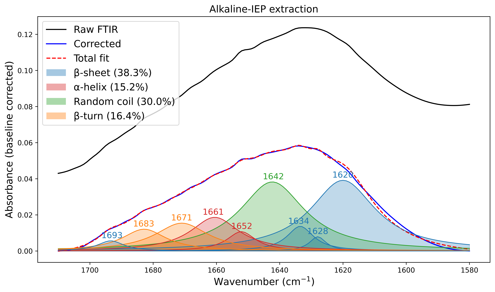

# FTIR Secondary-Structure Analysis of Faba Bean Proteins

This repository contains the code and example data for the FTIR secondary-structure analysis in the manuscript:

> Olagunju, O., Xu, Y., and Li, Y. *Effect of Extraction Methods on the Physicochemical, Structural, and Functional Properties of Faba Bean Proteins.* Manuscript in peer review.

The notebook estimates the protein secondary structure (β-sheet, α-helix, random coil, β-turn) from the amide I band (1600–1700 cm⁻¹) of FTIR spectra. It uses second-derivative peak detection and Lorentzian band fitting. The example data come from the faba bean protein isolate prepared by alkaline extraction and isoelectric precipitation (IEP).

## Repository contents

| Path | Contents |
|---|---|
| `FTIR-ALKALINE.ipynb` | Analysis notebook (alkaline-IEP sample) |
| `absorbance/` | Example data: 7 replicate absorbance spectra (`ALKALINE 1.csv` … `ALKALINE 8.csv`) and their average (`ALKALINE_average.csv`) |
| `figures/` | Example output: secondary-structure deconvolution of the alkaline-IEP sample |
| `my_data/` | Empty folder for your own spectra |
| `PROMPT.md` | A ready-made prompt for adapting the method to your own data with an AI assistant |

## Method

The final method is in the last two code cells of the notebook. The earlier cells are exploratory steps kept as a record.

1. **Average the replicates** point by point (cell 1).
2. **Select the amide I region**, 1580–1720 cm⁻¹.
3. **Correct the baseline** with a straight line between the two end points of the window.
4. **Find the bands.** Take the second derivative with a Savitzky–Golay filter (window 13, polynomial order 3) and detect peaks with `scipy.signal.find_peaks`.
5. **Assign each band to a structure** (after Kong and Yu, 2007):

   | Range (cm⁻¹) | Assignment |
   |---|---|
   | 1620–1640 | β-sheet |
   | 1640–1650 | random coil |
   | 1650–1660 | α-helix |
   | 1660–1670 | disordered α-helix / 3₁₀-helix (counted as α-helix) |
   | 1670–1685 | β-turn |
   | 1685–1700 | antiparallel β-sheet (counted as β-sheet) |
   | below 1620 | side chains (excluded) |

6. **Fit the bands.** Fit one Lorentzian band per detected peak plus a linear term. The centre is bounded to ±1 cm⁻¹ of the detected position, and the half-width to 3–12.5 cm⁻¹.
7. **Calculate the percentages.** Integrate each band (Simpson's rule), sum the areas by structure, and express each as a percentage of the total.
8. **Check the fit.** The notebook reports RMSE, AIC, and BIC. It also refits from perturbed starting values to test how stable the percentages are.

The bounds were tuned by trial and error against the second-derivative peaks and the assignment ranges above.

For the example alkaline-IEP spectrum, the result is β-sheet 38.3%, α-helix 15.2%, random coil 30.0%, and β-turn 16.4% (RMSE 0.00090):



## How to use

### Option A: run the notebook

1. Install the requirements:

   ```bash
   pip install numpy pandas scipy matplotlib jupyter
   ```

2. Clone the repository and open the notebook:

   ```bash
   git clone https://github.com/olusolaolagunju/Faba-Bean-FTIR-Secondary-Structure.git
   cd Faba-Bean-FTIR-Secondary-Structure
   jupyter notebook FTIR-ALKALINE.ipynb
   ```

3. Run the first cell, then the last two cells. You should get the example results above.
4. To analyze your own sample, copy your replicate files into `my_data/`. Change the file names in the first cell (for example `my_data/CONTROL 1.csv`) and in the `pd.read_csv(...)` calls of the last two cells.
5. Check the detected peaks in the peak-detection plot. Then update `peak_centres` and `labels` in the last cell to match your peaks. Refit, and adjust the bounds until no fitted centre or width sits exactly on a limit.

Your data files should have the wavenumber (cm⁻¹) in column 1 and absorbance in column 2. Lines starting with `#` are skipped. If your data are % transmittance, convert them first with A = 2 − log10(%T).

### Option B: let an AI assistant adapt it

If you are not comfortable editing code, you can let an AI assistant that runs code (for example, Claude with code execution turned on) adapt the method for you:

1. Download the repository as a ZIP file (green **Code** button > **Download ZIP**).
2. Unzip the folder and put your replicate files in `my_data/` and zip the folder again.
3. Upload the ZIP file to your AI model (e.g. ChatGPT)
4. Type 'Analyze my data in the chat'. 

The prompt asks the AI to:
- check that it reproduces the example values;
- apply the same method to your files;
- adjust the bounds automatically so no fitted value sits on a limit;
- run the statistics: fit quality, fit stability, replicate mean ± SD, and ANOVA with Tukey's test across samples;
- produce the figures and summary tables.

Always check the output against the example figure above.

## Notes

- All analyses use absorbance spectra.
- The replicate files are numbered 1–6 and 8; there is no `ALKALINE 7.csv`.
- The analysis was run with Python 3.12.

## Citation

If you use this code or data, please cite:

> Olagunju, O., Xu, Y., and Li, Y. *Effect of Extraction Methods on the Physicochemical, Structural, and Functional Properties of Faba Bean Proteins.* Manuscript in peer review.

```bibtex
@unpublished{olagunju_fababean_ftir,
  title  = {Effect of Extraction Methods on the Physicochemical, Structural, and Functional Properties of Faba Bean Proteins},
  author = {Olagunju, Olusola and Xu, Yixiang and Li, Yonghui},
  note   = {Manuscript in peer review}
}
```

## Contact

Olusola Olagunju, Department of Grain Science and Industry, Kansas State University. Corresponding author: Yonghui Li.
